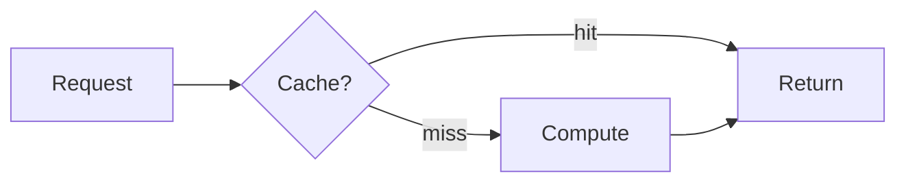

---
# ── Required ────────────────────────────────────────────────
title: "Post Title in Title Case"
summary: "One or two sentences that sell the post. Shown on the index card, the post header, and in social/SEO previews. Keep it under ~160 chars."
category: "AI Engineering"     # AI Engineering | Engineering | Database | System Design  (exactly one)
publishedAt: "2026-07-16"      # YYYY-MM-DD

# ── Optional ────────────────────────────────────────────────
tags: ["Node.js", "Reliability"]   # free-form; power the tag filter on /blog
updatedAt: "2026-07-20"            # show a "last updated" date if it changed
series: "Series Name"              # group multi-part posts (must match exactly across parts)
seriesOrder: 1                     # 1-based position within the series
draft: true                        # hidden in production builds; visible in dev
---

<!--
  ────────────────────────────────────────────────────────────
  HOUSE STRUCTURE — every post follows this skeleton.
  Copy this file to `your-slug.mdx`, set `draft: false` when ready.
  The filename (minus .mdx) becomes the URL: /blog/your-slug
  Reading time and the table of contents are generated automatically
  from your `##` / `###` headings — you don't write them.
  ────────────────────────────────────────────────────────────
-->

Open with a short **hook + context** (2–4 sentences, no heading). What problem
does this post solve, and why should the reader care? State the takeaway up
front — don't bury it.

## The Problem

Frame the concrete problem or question. Ground it in a real scenario. This is
the "before" state.

## Background / Key Concepts

Only the concepts the reader needs to follow the rest. Link out for the deep
dives instead of re-explaining everything.

## The Core Idea

The heart of the post — your approach, mechanism, or model. Break it into `###`
subsections as needed.

### A worked example

Show, don't just tell. Fenced code blocks are syntax-highlighted (light + dark):

```ts showLineNumbers
// Use `showLineNumbers` for numbered lines,
// and {2-3} after the language to highlight lines.
export function example() {
  return "highlighted";
}
```

Use callouts to flag things that matter:

<Callout kind="warn">
  A gotcha, sharp edge, or common mistake.
</Callout>

<Callout kind="tip">
  A practical shortcut or recommendation.
</Callout>

Diagrams use a fenced ```mermaid block (always use a fenced block for
multi-line diagrams — a `<Mermaid>` prop won't survive multi-line source):



## Trade-offs / When Not To Use This

Be honest about costs and limits. This section is what separates a real
engineering post from a tutorial.

## Takeaways

- 2–4 crisp bullets the reader should leave with.
- Mirror the promise you made in the intro.

*Further reading:* link primary sources, RFCs, or docs.
