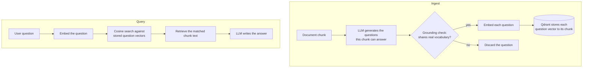

Standard RAG scored **0.753** on a query and returned the wrong page.

I built a version that scored **0.694** on the same query — lower — and returned
the right one.

If you're building anything that answers questions from your own docs or data,
that gap matters more than almost anything else in your pipeline. Here's what it
exposed, and the fix I ended up shipping as an open-source project called QIndex.

## The bug that doesn't look like a bug

I'm building **Solandra** - is an Support Operating System for the SMBs - in that, I've a feature AI powered widget that answers the customers query and on testing that hitting the same wall for not getting the context, even if the data existed in the vector db.

> **_Solandra_** - currently in development and testing phase and coming soon for all.

To reproduce it cleanly I pointed a plain RAG pipeline at the docs for STL — a little
table-syntax language I'd written earlier as OSS — and asked it something a real
user would ask:

> how write a button in stl syntax

Standard RAG matched it to the **link** documentation, not the **button**
documentation, because the link page happened to share more overlapping words
with my query. High similarity score. Wrong content. And the system reported
**0.753 confidence** while being completely wrong.

This is the failure mode nobody warns you about. RAG doesn't crash. It doesn't
error out. It confidently hands your user the wrong answer — and the confidence
score, the number you'd normally trust to catch exactly this, is the thing lying
to you.

<Callout kind="warn">
  A pipeline that fails loudly is a bug you'll fix. A pipeline that fails
  *confidently* is a bug that ships to production and quietly erodes trust in
  your product.
</Callout>

## Why it happens: documents don't talk like people

Standard RAG embeds document text. The problem is that documents and humans use
different vocabulary for the same intent.

```text
Doc says:   "Run the following npm command."
User asks:  "command to install the package."
```

Same intent. Zero shared keywords. Cosine similarity measures **word overlap,
not meaning** — so it misses matches like this constantly, and every so often it
_over_-matches the wrong page for the same reason. That's how you get a 0.753 on
the link docs when the user wanted the button docs.

## The fix: index the questions, not the chunks

The idea felt obvious in retrospect. If you want question-to-question matching,
then **index questions**.

So I flipped what gets embedded. Instead of embedding the raw chunk text, an LLM
generates — once, at ingest — every question that chunk could plausibly answer.
_Those_ questions get embedded, not the prose. At query time I'm matching the
user's question against stored questions: like against like, instead of hoping
two different kinds of language happen to overlap.



For the button query, QIndex matched the user against a stored question —
_"how do I create a button element in STL syntax?"_ — directly, and returned the
right page at 0.694. Lower score, correct answer. The score dropped because the
match is now honest.

## Two guardrails that keep it honest

Generating questions with an LLM opens two obvious ways to make things worse, so
each has a guard:

- **A grounding check.** Every generated question must share at least two
  meaningful words (longer than four characters) with its source chunk.
  Questions that don't are discarded. This stops the LLM from hallucinating
  generic questions that would pollute the index.
- **A confidence floor.** Below **0.60**, the system says _"I don't have enough
  information about that"_ instead of guessing.

<Callout kind="tip">
  Silence is better than confident wrongness. A retrieval layer that knows when
  to abstain is worth more than one that always has an answer.
</Callout>

## Chunking mattered more than I expected

Here's the part I underestimated: question quality is downstream of **chunk**
quality. Most RAG uses token-based chunking — split every N tokens with an
overlap — which happily cuts mid-sentence, mid-list, mid-code-block. Feed an LLM
a chunk that starts halfway through a thought and it generates vague, generic
questions that fail the grounding check.

So QIndex chunks structurally, with a cascade:

1. **H2/H3 boundaries first** — each section becomes its own chunk, keeping a
   coherent topic.
2. **Paragraph split next** — only if a section is too large (list blocks stay
   atomic).
3. **Sentence split last** — only when a single paragraph blows the word limit.
4. **Full-page shortcut** — pages under 500 words stay as one chunk.
5. **Page summary prepended** — every chunk carries its source URL, page title,
   and first paragraph, so it's self-contained even out of context.

A coherent section produces grounded, specific questions. That's the whole ball
game.

## Did it actually work?

Tested against [stl.fysk.dev](https://stl.fysk.dev) — 19 pages, ~80 indexed
questions. Same queries, same corpus, head to head:

| Query                                           | Standard RAG                  | QIndex                            |
| ----------------------------------------------- | ----------------------------- | --------------------------------- |
| "how write a button in stl syntax"              | 0.753 — **wrong** (link docs) | 0.694 — **correct** (button docs) |
| "what is the use of action attribute in button" | —                             | **0.873** correct                 |
| "what is the use of targetId in button"         | —                             | **0.889** correct                 |
| "why should I use STL over other table plugins" | 0.853 correct                 | 0.854 correct                     |

And across a spread of natural-language queries, QIndex stayed both accurate and
well above the confidence floor:

| Query                                                 | Top score | Result                    |
| ----------------------------------------------------- | --------- | ------------------------- |
| "command to install the structured-table package"     | 0.807     | `npm i structured-table`  |
| "what is the use of targetId in button in STL syntax" | 0.889     | Correct                   |
| "how to add a button in the stl syntax"               | 0.694     | Correct                   |
| "how can I use this in my project"                    | 0.724     | Correct (multi-framework) |

## The gap I haven't closed yet

Being honest about the edges: short keyword/command queries still underperform
natural-language ones.

```text
"command to install the stl package"  →  0.560  (below threshold, abstains)
"how to install the structured-table" →  0.771  (answers correctly)
```

Same intent, very different scores. The fix I have planned — not yet shipped — is
a `normalize_query()` step that rewrites a user's query into a canonical question
form _before_ embedding, so a terse command phrases itself like the questions in
the index.

## The trade-off

QIndex isn't free. It spends one LLM call per chunk at ingest to generate
questions, so ingestion costs more than standard RAG.

|                     | Standard RAG  | QIndex                             |
| ------------------- | ------------- | ---------------------------------- |
| What's embedded     | Chunk text    | LLM-generated questions            |
| Query match         | Query ↔ prose | Question ↔ question                |
| Chunking            | Token-based   | Heading/paragraph cascade          |
| Hallucination guard | Prompt only   | Confidence floor + grounding check |
| Ingest cost         | Low           | Higher                             |

For a support knowledge base — ingest once, answer thousands of queries — paying
more up front for retrieval precision is the right trade every time.

## The part that made me trust the idea

After I shared an early version, a friend sent me a 2025 paper out of Seoul
National University describing almost the same core mechanism: index questions,
not chunks. I'd never seen it. I built this solving my own problem on an
unrelated project.

I don't read that as "someone got there first." Two people arriving at the same
answer independently, without comparing notes, is usually a sign the answer is
just correct.

## Try it

QIndex is open source, MIT licensed, and runs fully local with Ollama or with
your own API keys. After you clone it and set up Ollama (or your keys), it's two
commands:

```bash
# Ingest a documentation site
python qindex_rag_local.py ingest https://docs.yoursite.com 30

# Ask a question
python qindex_rag_local.py ask 'how do I install the package'
```

Full benchmarks and architecture are in the README:
👉 [github.com/ameghcoder/qindex-rag](https://github.com/ameghcoder/qindex-rag)

## Takeaways

- RAG's worst failure is silent: the wrong answer with a high confidence score.
  Don't trust similarity as a correctness signal.
- The mismatch is vocabulary vs. intent. Matching a user's question against
  **stored questions** aligns far better than question-against-prose.
- Guard the generation: a grounding check keeps questions honest, a confidence
  floor lets the system abstain instead of guessing.
- Structural chunking isn't a detail — coherent chunks are what make the
  generated questions good.

If you're hitting wrong-answer problems in a RAG pipeline, I genuinely want to
know what's breaking for you — that's how the next iteration gets built. And if
QIndex is useful, a ⭐ helps it get found; that's the only "algorithm" open
source has.
